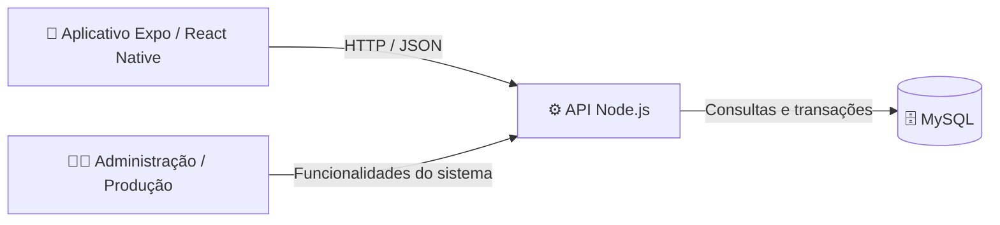

<div align="center">

# 🛒 SENAI EXPRESS

### Pedidos mais simples. Atendimento mais ágil. Tecnologia na prática.

Aplicativo de pedidos desenvolvido como projeto de TCC, com interface mobile, API própria e banco de dados relacional.

[](https://reactnative.dev/)
[](https://expo.dev/)
[](https://nodejs.org/)
[](https://www.mysql.com/)

**[Sobre](#-sobre-o-projeto) · [Funcionalidades](#-funcionalidades) · [Instalação](#-como-executar) · [Estrutura](#-estrutura-do-projeto) · [Segurança](#-segurança)**

</div>

---

## 📖 Sobre o projeto

O **SENAI Express** é uma solução de pedidos para o ambiente educacional, criada para conectar clientes, administração e preparação de pedidos em um único sistema.

O projeto utiliza um aplicativo mobile em **React Native com Expo**, uma API construída com **Node.js** e persistência de dados em **MySQL**. O objetivo é aplicar, em um produto real, conceitos de desenvolvimento mobile, backend, banco de dados, autenticação e experiência do usuário.

> **Nota sobre versões:** o repositório pode representar uma versão específica do projeto. Antes da publicação, confira quais recursos estão efetivamente implementados e testados na versão enviada. As funcionalidades listadas a seguir descrevem os módulos do projeto e não garantem que todos estejam concluídos em qualquer versão.

## ✨ Funcionalidades

| Módulo | O que oferece |
| :--- | :--- |
| 🏠 **Catálogo** | Visualização de produtos e suas informações. |
| 🛒 **Carrinho e pedidos** | Seleção de itens e fluxo de solicitação de pedidos. |
| 👤 **Conta e perfil** | Cadastro, acesso e gerenciamento de informações do usuário. |
| 📅 **Agenda** | Interface para organização de horários, conforme a versão. |
| 🧑‍💼 **Administração** | Área administrativa para gerenciamento de informações e produtos. |
| 👨‍🍳 **Cozinha / produção** | Área dedicada ao acompanhamento da preparação, conforme a versão. |
| 🗄️ **Persistência** | Armazenamento estruturado das informações no banco de dados MySQL. |

### 💡 Recursos planejados ou em evolução

Os seguintes recursos fazem parte da proposta de evolução do SENAI Express. **Não devem ser apresentados como concluídos sem testes na versão publicada**:

- Login biométrico (Face ID / impressão digital).
- Programa de pontos e recompensas.
- QR Code para identificação de pedidos.
- Notificações e atualizações de status.
- Relatórios e indicadores administrativos.
- Temas claro/escuro, microinterações e animações.
- Fluxos ampliados de pagamento simulado, agendamento e produção.

## 🧰 Tecnologias utilizadas

| Camada | Tecnologias |
| :--- | :--- |
| **Mobile** | React Native, Expo, JavaScript |
| **Backend** | Node.js, JavaScript, Express *(confira no `package.json`)* |
| **Banco de dados** | MySQL |
| **Integração** | API HTTP / JSON |
| **Ferramentas** | VS Code, Git, GitHub, npm |

## 🏗️ Arquitetura



## 📁 Estrutura do projeto

A organização pode variar entre versões. Utilize a pasta principal que contém os componentes abaixo:

```text
SENAI-Express/
├── backend/               # API e regras de negócio
│   ├── src/               # Código-fonte do servidor
│   ├── package.json       # Dependências e scripts
│   └── .env.example       # Exemplo de configuração (sem senhas reais)
├── mobile/                # Aplicativo React Native / Expo
│   ├── package.json
│   └── ...
├── database/              # Scripts de criação/atualização do banco
│   └── ...
├── .gitignore
└── README.md
```

> A árvore acima é **ilustrativa**. Não crie pastas ou arquivos vazios apenas para reproduzi-la: adapte aos arquivos reais do repositório.

## 🚀 Como executar

### Pré-requisitos

- **Node.js** e **npm** instalados.
- **MySQL** instalado e em execução.
- **Git** para clonar o projeto.
- **Expo Go** no celular ou um emulador compatível.
- Computador e celular conectados à **mesma rede Wi-Fi**, caso teste pelo Expo Go em rede local.

### 1. Clonar o repositório

Substitua `SEU-USUARIO` pelo seu perfil no GitHub:

```bash
git clone https://github.com/SEU-USUARIO/SENAI-Express.git
cd SENAI-Express
```

Se sua versão tiver pastas intermediárias, navegue até a pasta em que `backend`, `mobile` e `database` estão localizados.

### 2. Preparar o banco de dados

1. Abra seu gerenciador do MySQL.
2. Localize o script `.sql` correspondente à versão do projeto na pasta `database`.
3. Execute o script para criar o banco e as tabelas.
4. Confirme o nome criado e use **o mesmo nome** no `DB_NAME` do backend.

> **Atenção:** versões anteriores podem usar bancos diferentes. Não execute scripts destrutivos sobre um banco de outra versão (por exemplo, o banco da V3) sem um backup e uma confirmação explícita.

### 3. Configurar e iniciar a API

Abra um terminal:

```bash
cd backend
npm install
```

Crie `backend/.env` localmente com as variáveis exigidas pela sua versão. Exemplo de desenvolvimento:

```dotenv
PORT=3334
DB_HOST=localhost
DB_PORT=3306
DB_USER=seu_usuario_mysql
DB_PASSWORD=sua_senha_mysql
DB_NAME=senai_express_v6
JWT_SECRET=coloque_aqui_um_segredo_aleatorio_com_32_caracteres_ou_mais

# Necessárias apenas se sua versão possuir o script de criação de admin
ADMIN_NAME=Administrador
ADMIN_EMAIL=admin@exemplo.local
ADMIN_PASSWORD=defina_uma_senha_forte_aqui
```

**Importante:** os valores são **exemplos**, não credenciais prontas. `DB_NAME`, `PORT` e os nomes das variáveis precisam corresponder à implementação do seu backend. Nunca envie o `.env` ao GitHub.

Inicie o servidor:

```bash
npm run dev
```

Se a versão tiver o script `create-admin` configurado no `backend/package.json`, você pode criar uma conta administrativa em **outro terminal**, depois de configurar as variáveis necessárias:

```bash
npm run create-admin
```

### 4. Iniciar o aplicativo

Abra outro terminal, na pasta do projeto:

```bash
cd mobile
npm install
npx expo start
```

Leia o QR Code apresentado no terminal com o **Expo Go**, conforme a compatibilidade do SDK instalado.

**Conexão com o backend:** em um celular físico, `localhost` aponta para o próprio celular, e não para o computador. Configure a URL da API **no local já previsto pelo seu código** usando o IP local do computador, por exemplo `http://192.168.1.10:3334`. Substitua o IP e a porta pelos valores reais da sua rede e do servidor.

Se houver erro de conexão, verifique a rede Wi-Fi, a porta configurada e as regras de firewall do computador.

## 🔐 Segurança

Antes de tornar o repositório público:

- Nunca publique arquivos `.env`, senhas, tokens, chaves JWT ou credenciais de administrador.
- Ignore pastas `node_modules/` e arquivos gerados automaticamente.
- Não inclua dados pessoais reais ou backups completos de bancos com informações de usuários.
- Utilize senhas fortes e usuários MySQL com permissões adequadas.
- Se alguma credencial tiver sido enviada ao GitHub por engano, **troque a credencial**; apagá-la apenas do arquivo mais recente não remove sua exposição do histórico.

Modelo recomendado de `.gitignore` na raiz:

```gitignore
node_modules/
.env
.env.*
!.env.example
.expo/
dist/
build/
coverage/
*.log
*.zip
```

## 📸 Demonstração do aplicativo

Adicione aqui capturas reais das telas **somente depois de confirmar a versão publicada**. Sugestões: catálogo, carrinho, perfil, administração e produção.

Você pode organizar as imagens em `docs/images/` e inserir links como:

```markdown

```

## 🧭 Próximos passos

- [ ] Validar os fluxos do aplicativo em dispositivo físico.
- [ ] Revisar permissões e autenticação das diferentes áreas.
- [ ] Criar testes automatizados para os fluxos críticos.
- [ ] Documentar as rotas da API e os scripts de banco de dados.
- [ ] Adicionar prints reais e um vídeo demonstrativo.
- [ ] Atualizar a lista de recursos concluídos de acordo com a versão publicada.

## 🎓 Contexto acadêmico

Projeto desenvolvido no contexto do **Trabalho de Conclusão de Curso (TCC)**, com foco em desenvolvimento de software, integração entre aplicação mobile e backend e modelagem de dados.

**Instituição:** SENAI  
**Projeto:** SENAI Express  
**Autor(es):** *adicione os nomes da equipe*  
**Ano:** 2026

## 📜 Licença

**Licença ainda não definida.** Caso o projeto seja distribuído sob uma licença de código aberto, escolha uma licença apropriada, adicione o arquivo `LICENSE` à raiz e atualize esta seção.

---

<div align="center">

**SENAI EXPRESS — Tecnologia aplicada para transformar ideias em soluções.**

Feito para aprender, desenvolver e evoluir. 🚀

</div>
